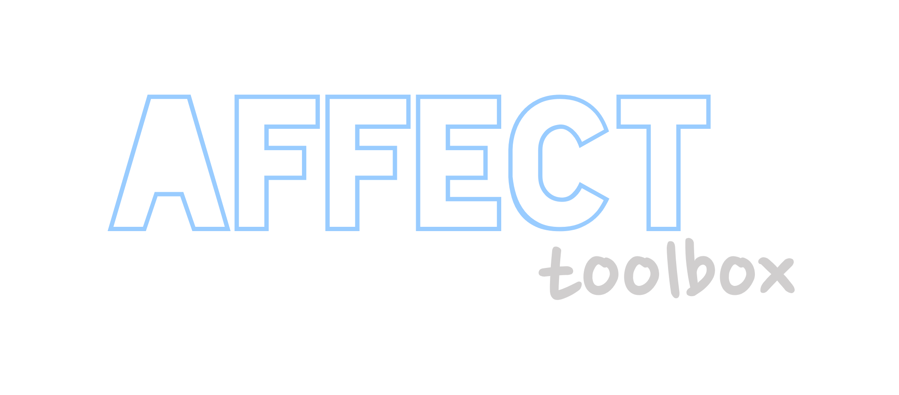
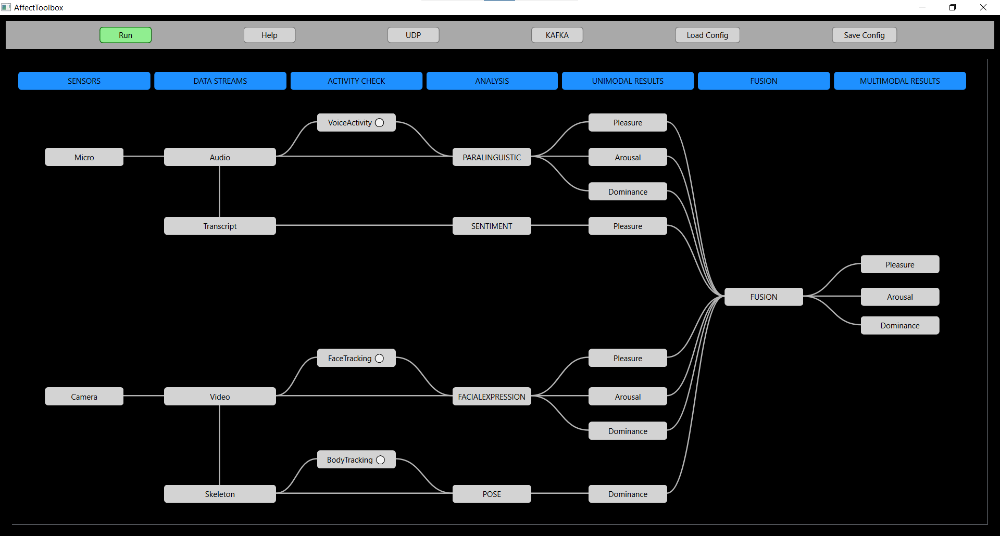

# The AffectToolbox: Affect Analysis for Everyone
## **1. What it is about**
The AffectToolbox provides a user-friendly solution for multimodal realtime analysis of Pleasure, Arousal and Dominance. See our paper for in-depth information: 
[ArXiv Link](https://arxiv.org/pdf/2402.15195)

And here is how it looks:


## **2. Installation**
**** For getting access to a one-click-installer, please write an email to Silvan Mertes (silvan.mertes@uni-a.de). (We are still working on licence stuff before we can upload it on Github)****

For the standard installation (recommended!) via Python environment do the following:
- Clone repository
- Install [uv](https://docs.astral.sh/uv/getting-started/installation/) (Windows: `winget install --id astral-sh.uv -e`), then restart your terminal or IDE.
- Run `uv sync --locked --managed-python` in the repository root. uv downloads the Python 3.9 version in `.python-version`, creates `.venv`, and installs the locked dependencies. The current environment targets Windows x64.
- Download ressource folder here: ToDo
- Unzip, then put the res-Folder in root-Directory of this repository
- Run `uv run --locked main.py`.

In PyCharm, select `.venv\Scripts\python.exe` as the project interpreter after syncing. You can run `main.py` normally from the IDE.

Dependencies are maintained in `pyproject.toml`; `uv.lock` records the resolved versions. Commit both files and `.python-version`, but never commit virtual environments. To change a dependency, use `uv add "package==version"` and verify the application before committing the updated lockfile. Legacy package versions are retained for this migration, including explicit build constraints for Whisper's older build script.

`requirements.txt` is a compatibility export, not the dependency source. Regenerate it after dependency changes with `uv export --locked --format requirements-txt --no-hashes --output-file requirements.txt`.

To run the existing automated checks: `uv run --locked python -m unittest discover -s tests -v`. Model resources, FFmpeg where required, and camera/microphone devices are external prerequisites; uv does not install them.

## **3. Cite us :-)**
If you use the AffectToolbox (or parts of it) for scientific reasons, please cite us in your publication. 
```
@inproceedings{mertes2024affecttoolbox,
  title={The AffectToolbox: Affect Analysis for Everyone},
  author={Mertes, Silvan and Schiller, Dominik and Dietz, Michael and Andr{\'e}, Elisabeth and Lingenfelser, Florian},
  booktitle={2024 12th International conference on affective computing and intelligent interaction (ACII)},
  year={2024},
  organization={IEEE}
}
```
